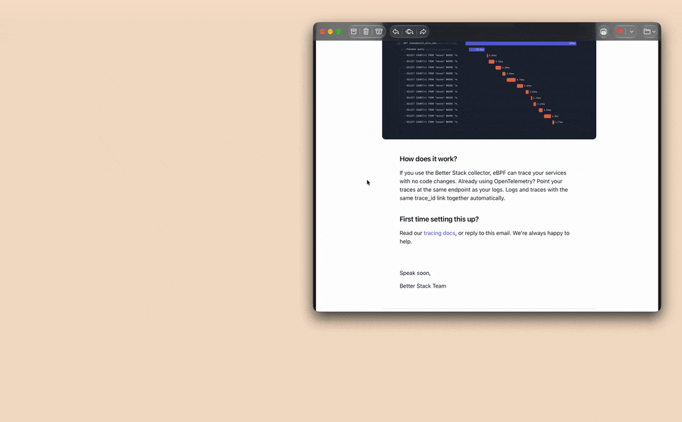
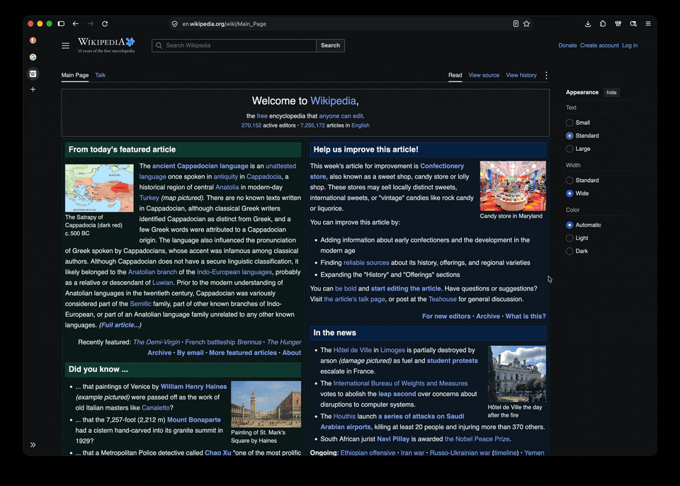
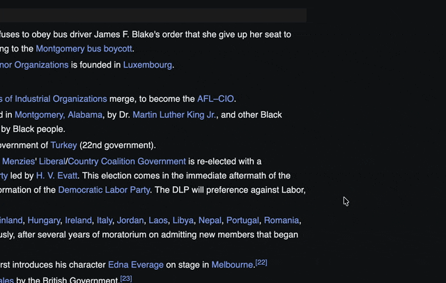

# Minifox

A mini window for links from other apps and Shift+click link previews, for Firefox.
Inspired by Arc's Little Arc and Peek. Not affiliated with The Browser Company or Mozilla.

## Mini window

Links you open in other apps land in a compact window in the middle of the screen
instead of a new tab. **Open in Firefox** (⇧⌘O) moves the page to the main window.



The toolbar hides when you scroll down and comes back when you scroll up or move the
pointer to the top. Click the URL to copy it. macOS only — routing uses
[Finicky](https://github.com/johnste/finicky).

## Peek

Shift+click any link to preview it in an overlay. **Open in tab** (⇧⌘O) keeps it, Esc
closes it.



Sites that forbid embedding (GitHub, Google, …) still load in the preview.

## Copy URL

⇧⌘C copies the page URL — in Peek, the previewed page.



Everything opened from a tab keeps its container; private stays private.

## Install

1. Download `minifox-<version>.xpi` from the [latest release](../../releases/latest),
   drag it into Firefox and allow access to all sites. Updates install automatically.
2. In `about:config` set `browser.tabs.loadDivertedInBackground` to `true` — otherwise
   Firefox raises the main window for every external link before the mini window
   appears.
3. macOS, for the mini window — Finicky routes links from other apps:
   ```sh
   brew install --cask finicky
   cp extras/finicky.js ~/.finicky.js   # from this repo or the release
   open -a Finicky                      # accept the default-browser prompt
   ```
   Check: `open https://github.com` in Terminal opens the mini window.

## Shortcuts

| | macOS | Windows / Linux |
|---|---|---|
| Open full — mini window → main window, Peek → tab | ⇧⌘O | Ctrl+Shift+O |
| Copy page URL | ⇧⌘C | Ctrl+Shift+C |
| Peek a link | Shift+click | Shift+click |
| Close Peek | Esc | Esc |
| Close mini window | ⌘W | Ctrl+W |

*Open full* can be rebound in `about:addons` → ⚙ → **Manage Extension Shortcuts**. The
defaults replace Firefox's *Show All Bookmarks* and the devtools element picker.

## Good to know

- In Peek you may look logged out: Total Cookie Protection gives the preview its own
  cookies. *Open in tab* opens the page with your session.
- Peek and the toolbar don't run on `about:` pages and addons.mozilla.org.
- To keep some apps or sites out of the mini window, add them to `SKIP_OPENERS` /
  `FULL_WINDOW_HOSTS` in `~/.finicky.js`. Firefox Developer Edition: rename both
  `"Firefox"` there to `"Firefox Developer Edition"`.

<details>
<summary>More: mini window size, hiding Firefox's own toolbar, quirks</summary>

- Mini window size and position: `SIZE`, `POSITION` (`"center"` or `"top-right"`) and
  `MARGIN` in `src/background.js`.
- Firefox's read-only address bar in the mini window can be hidden with
  `userChrome.css` (set `toolkit.legacyUserProfileCustomizations.stylesheets = true`,
  restart). It also hides the address in sign-in popups:
  ```css
  #main-window[chromehidden~="toolbar"] #nav-bar { visibility: collapse !important; }
  ```
- An external link briefly creates a background tab before the mini window replaces it.
  If the main window still flashes forward, check the `about:config` pref and relaunch
  Finicky.
- `browser.tabs.loadDivertedInBackground` also backgrounds `target="_blank"` links;
  Minifox brings tabs opened by a plain click to the front (⌘-click and middle-click stay
  in the background).
- Popups that sites open themselves (OAuth, payments) are left alone. Mini windows
  restored after a Firefox restart become plain popups.

</details>

## Development

```sh
nvm use && pnpm install
pnpm start                # Firefox with src/ loaded, auto-reload
pnpm check && pnpm lint   # what CI runs
pnpm icons                # re-render src/icons/*.png from assets/icons/*.svg
```

Only `src/` is packaged. The `#minifox_open_in_mini` / `#minifox_open_in_main` markers
are a contract between `extras/finicky.js` and `src/background.js` — change both together.

**Release:** `pnpm release 1.2.3 && git push --follow-tags`. The tag workflow signs the
`.xpi` with AMO (secrets `AMO_JWT_ISSUER`, `AMO_JWT_SECRET`), publishes a GitHub Release
and updates `updates.json` for auto-updates.
